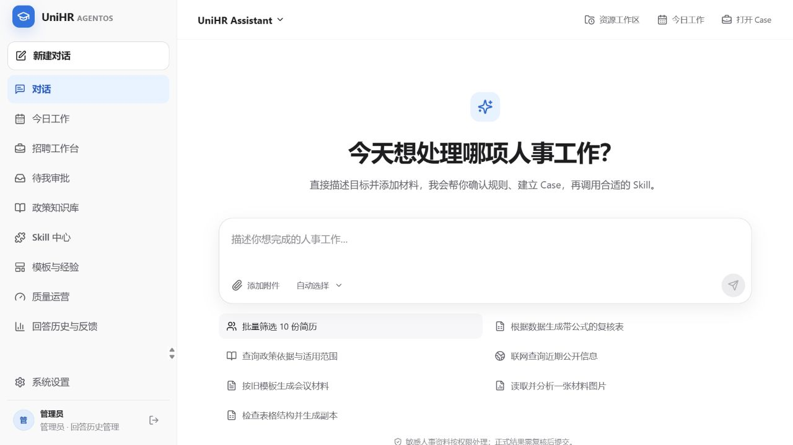
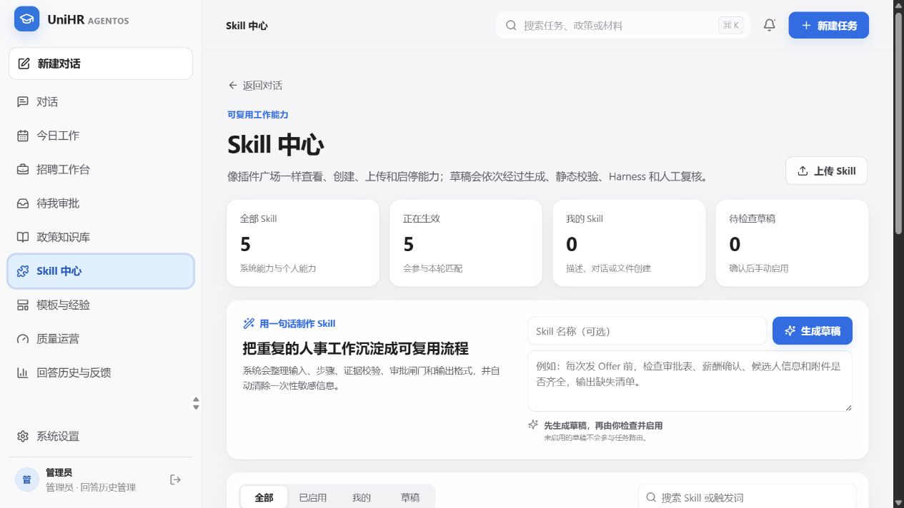
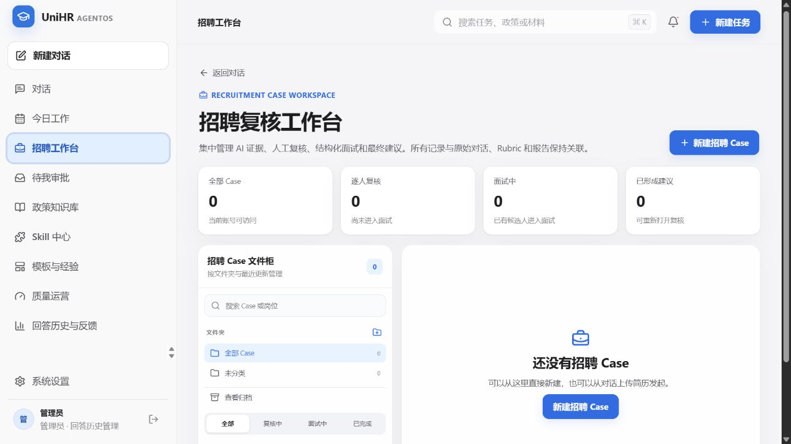
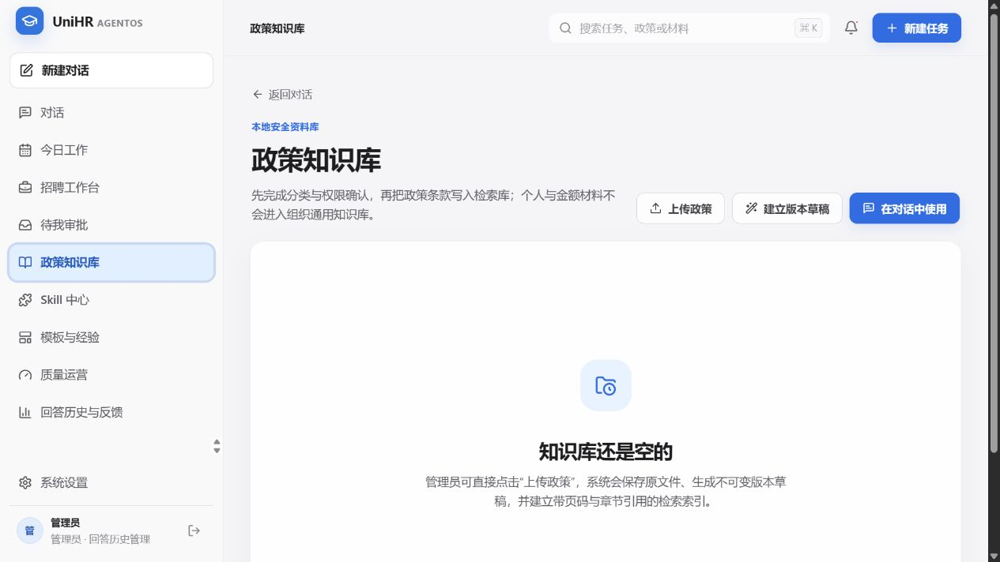
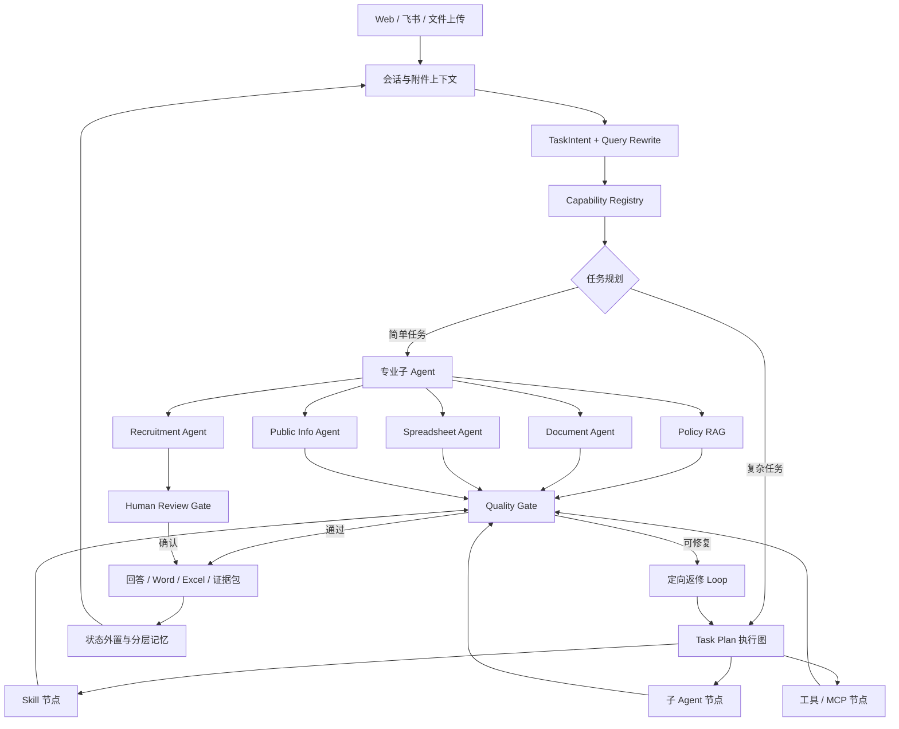
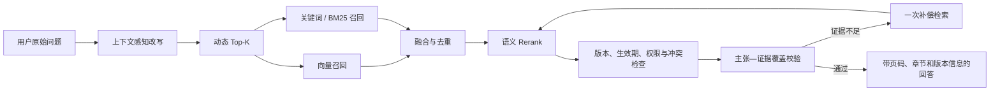

<div align="center">

# UniHR AgentOS

### 把散落的政策变成有出处的答案，把重复的人事工作变成可复用的数字流程

**Policy RAG · Multi-Agent · LangGraph Loop · Skill Orchestration · Word / Excel Artifacts · Feishu Digital Employee**

[快速开始](#三分钟启动) · [上传自己的政策](#第一件事上传你自己的政策) · [系统架构](#它不是一个聊天壳) · [隐私边界](#公开版不包含什么)

</div>

---

## 产品一览

> 以下页面由公开版在全新空数据库中真实运行并截图，仅包含系统内置能力与虚构演示信息，不含任何单位政策、简历或历史会话。

### 从一句自然语言开始，让系统自己决定调用什么能力



### 能力可以沉淀、检查、试运行和版本化



| 招聘复核工作台 | 自有政策知识库 |
|---|---|
|  |  |

主对话负责理解目标和连续追问，专业工作台负责承载 Case、证据、文件、人工复核与长期状态；两者通过同一套任务路由、Skill、记忆和执行图连接。

## 为什么做 UniHR

真实的人事工作很少只是“查一条制度”。一次看似简单的任务，往往同时需要理解政策、核对附件、处理表格、生成公文、保留证据、等待人工确认，并在几天后接着上次的进度继续。

UniHR AgentOS 把这些工作放进同一张工作台：

- 问政策时，它先改写问题，再做混合检索、版本判断与证据核验；
- 处理复杂任务时，它会生成执行计划，让多个 Agent、Skill 和工具按依赖关系协作；
- 生成 Word 或 Excel 时，它不只返回一段文字，而是产出可下载文件并经过 Artifact Harness 校验；
- 对话很长时，它不会把所有历史不断塞回模型，而是通过渐进式披露、状态外置和分层记忆保留真正有用的信息；
- 遇到招聘筛选、审批或敏感决策时，它把最终判断留给人，而不是替人做不可解释的决定。

一句话说：**它不是“会聊天的人事知识库”，而是一套能理解任务、调用能力、留下过程并交付文件的人事数字员工底座。**

## 你可以用它做什么

| 场景 | UniHR 的工作方式 |
|---|---|
| 政策问答 | Query Rewrite → 混合召回 → 动态 Top-K → Rerank → 版本/冲突检查 → 带引用回答 |
| 政策入库 | 上传 PDF、DOCX、Markdown 或 TXT → 解析 → 条款级切片 → 版本草稿 → 人工发布 |
| 公文材料 | 理解文种、事实和版式要求 → 生成 Word → 检查结构、占位符与渲染结果 |
| 表格任务 | 把自然语言编译为表格计划 → Python / openpyxl 执行 → 公式、数据、样式与渲染验证 |
| 简历辅助筛选 | 多简历解析 → 岗位维度评分 → 原文证据定位 → 人工复核排名 → Excel 报告 |
| Skill 中心 | 一句话生成 Skill、从对话沉淀 Skill、上传 Skill、版本管理、Dry Run 与回滚 |
| 复杂连续任务 | Task Plan 把 Agent、Skill 和工具组织成有依赖关系的执行图，并在质量门失败时定向返修 |
| 飞书数字员工 | 可选接入飞书机器人，在群聊中 @UniHR 调用相同路由、知识和 Skill 能力 |

## 三分钟启动

### 前置环境

- Windows 10/11（当前一键脚本面向 Windows）
- Python 3.11+
- Node.js 20+
- Docker Desktop
- 一个可用的阿里云百炼 / DashScope API Key

### 1. 下载并安装依赖

```powershell
git clone https://github.com/DominicHongliDing/UniHR-AgentOS.git
cd UniHR-AgentOS
.\setup.ps1
```

### 2. 只填写一项配置

打开根目录的 `.env`：

```dotenv
UNIHR_BAILIAN_API_KEY=你的百炼APIKey
```

模型路由、Embedding、Rerank、本地数据库目录与 PostgreSQL Checkpointer 已提供可运行默认值。若你的百炼账号没有某个默认模型，可在同一文件里替换模型名称。

### 3. 启动

```powershell
.\start.ps1
```

浏览器会打开 [http://127.0.0.1:5180](http://127.0.0.1:5180)。

本地演示账号：

| 角色 | 用户名 | 密码 |
|---|---|---|
| 管理员 | `admin` | `UniHR@2026` |
| 普通 HR | `hr-user` | `UniHR@2026` |

> 这些账号只用于本地演示。共享部署前请修改 `.env` 中的密码与 `APP_JWT_SECRET_KEY`。

## 第一件事：上传你自己的政策

公开仓库是一个**空知识库**，不包含任何单位的真实政策、简历或人事数据。

1. 用管理员账号登录；
2. 打开“政策知识库”；
3. 点击“上传政策”；
4. 选择 PDF、DOCX、Markdown 或 TXT；
5. 等待系统生成不可变版本草稿；
6. 查看解析证据，完成质量复核并发布；
7. 回到对话页，用自己的说法提问。

你也可以先上传 [`examples/虚构政策示例.md`](examples/虚构政策示例.md)，测试从入库到引用回答的完整链路。

## 它不是一个聊天壳



### 三层编排，各司其职

- **子 Agent**：负责一个专业领域，例如政策问答、公文生成、表格处理或招聘筛选。
- **Skill**：封装可复用的业务方法、模板与约束，例如“会议纪要生成”或“政策版本比对”。
- **Task Plan 执行图**：当任务需要多种能力协作时，负责安排先后依赖、并行节点、质量门和失败后的返修路径。

这三者不是互相替代：Agent 负责判断，Skill 提供稳定做法，执行图负责把它们组织成一件完整工作。

## Policy RAG 的检索链路



系统不会把“检索到相关文件”等同于“已经回答了问题”。它继续检查证据是否直接支持关键主张，区分当前有效、部分支持、互相冲突和无答案。

## 记忆与长任务

UniHR 把上下文当作有生命周期的产品资源：

- **Working Memory**：当前目标、约束、最近工具结果和下一步；
- **Thread State / Checkpoint**：LangGraph 节点状态，支持暂停、复核与继续；
- **Semantic Memory**：稳定偏好、组织规则和可复用事实；
- **Episodic Memory**：过去任务的关键决策与结果；
- **Procedural Memory**：以 Skill 形式沉淀的可复用工作方法；
- **External Memory**：原文件、表格、文档、报告和证据包留在工作区，模型只按需读取。

长对话达到阈值后，系统压缩低价值历史，保留目标、约束、决策、未完成事项与最近原始上下文。它追求的不是“无限上下文”，而是“放得下、找得到、还能接着做”。

## 技术栈

- Frontend：React 19、TypeScript、Vite、React Flow
- Backend：FastAPI、Pydantic、Python 3.11+
- Agent Runtime：LangGraph、PostgreSQL Saver、Capability Registry、自研任务规划与 Harness
- RAG：百炼 Embedding、混合检索、动态 Top-K、Rerank、Query Rewrite、版本与证据治理
- Artifacts：python-docx、openpyxl、PyMuPDF、Pillow
- Channels：Web、飞书机器人（可选）

详细设计见 [`docs/ARCHITECTURE.md`](docs/ARCHITECTURE.md)。

## 公开版不包含什么

为了避免把演示项目变成数据泄露样例，以下内容不会进入 Git：

- 任何真实政策原文或内部制度；
- 简历、身份证号、薪酬表、聊天记录与用户反馈；
- SQLite / PostgreSQL 数据、向量索引和 LangGraph Checkpoint；
- 生成的 Word、Excel、PDF 和预览图；
- 百炼、飞书、Tavily、Firecrawl 等服务密钥；
- 本机路径、浏览器数据、日志和 Office 临时文件。

详细边界见 [`docs/PRIVACY.md`](docs/PRIVACY.md)。公开仓库启用 GitHub Secret Scanning / Push Protection 后，可进一步阻止密钥误提交。

## 项目状态

UniHR AgentOS 目前定位为可运行的产品 Demo 与 AI 产品工程样例，并非开箱即用的生产级 HRIS。招聘评分只用于辅助人工复核，不构成自动录用或淘汰决定；正式政策答复仍应由有权限的人员核验适用范围与最终口径。

## 贡献

欢迎提交 Issue、能力适配器、Skill、评测集和改进建议。请先阅读 [`CONTRIBUTING.md`](CONTRIBUTING.md) 与 [`SECURITY.md`](SECURITY.md)。

## License

[MIT](LICENSE)
