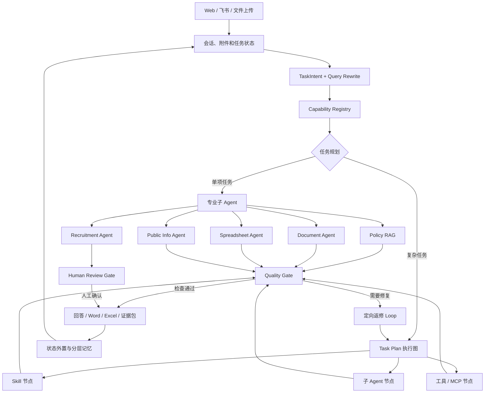
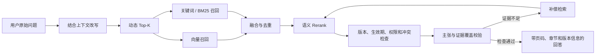

<div align="center">

# UniHR AgentOS

### 一套从高校人事实务中长出来的 AI 工作台

政策回答有出处，复杂任务能接着做，Word 和 Excel 可以直接交付。

[了解产品](#这个项目从哪里来) · [查看典型任务](#四类典型任务) · [本地启动](#本地启动) · [系统设计](#系统如何工作)

</div>

---

## 这个项目从哪里来

我在国际医学院工作期间，除了承担日常行政工作，也参与了一项 AI 提效课题。为了找到真正值得自动化的环节，我进入人力资源部门了解他们每天处理的政策查询、简历筛选、重复表格、公文材料和审批工作。

这些工作经常跨越多个文件和系统。查政策时，不仅要找到相似条文，还要确认版本、适用范围和原文出处；做年度调整时，规则可能没有变化，但人员数据和年份需要整套替换；筛选简历时，招聘人员希望快速比较候选人，又必须保留逐项证据并由人作最终判断；写通知和会议材料时，内容、格式、落款和附件都需要反复核对。

UniHR AgentOS 从这些具体任务开始迭代。它把对话、政策、文件、表格、审批和可复用流程放进同一套工作机制，让 HR 可以从一句话或一批材料开始，最后拿到带依据的回答、可下载文件或等待复核的 Case。

## 四类典型任务

| HR 想完成的工作 | UniHR 如何处理 | 最终交付 |
|---|---|---|
| 查询一项人事政策 | 理解追问和上下文，检索政策原文，核对版本与适用范围 | 带文件、页码和条款依据的回答 |
| 比较多份候选人简历 | 读取岗位要求和简历，逐项寻找原文证据，标记缺口 | 候选人比较结果、待核实问题和 Excel 报告 |
| 制作通知、会议材料或业务表格 | 把自然语言要求整理成内容与版式计划，再调用文档或表格工具 | 可修改的 Word、Excel 以及自动校验摘要 |
| 处理跨步骤的连续任务 | 保存任务状态，安排 Agent、Skill 和工具的先后关系，在失败处定向返修 | 可暂停、复核、继续和追溯的完整 Case |

飞书机器人可以接入同一套能力。在群聊中 @UniHR 后，用户可以查询公开信息、调用人事 Skill 或继续已有任务，不需要再学习一套新的操作方式。

## 产品界面

### 从一句自然语言开始


主对话负责确认用户目标、接收附件和处理连续追问。任务进入执行后，政策证据、生成文件、人工复核和运行状态会留在对应的工作区，而不是只存在于一段聊天记录里。

### 把做过的工作沉淀成 Skill


用户可以用一句话创建 Skill，也可以把一段已经跑通的对话整理成流程。Skill 在启用前会经过静态检查、隔离试运行和人工确认，并保留版本，避免一条未经验证的提示词直接进入正式任务。

## 一个任务怎样完成

以批量简历筛选为例：

1. HR 输入岗位名称、必须条件和加分项，并上传多份简历；
2. 系统确认这是招聘任务，建立 Recruitment Case；
3. Recruitment Agent 读取材料，按照岗位维度寻找原文证据并生成初步评分；
4. 公平性检查排除与岗位胜任力无关的敏感属性；
5. 系统生成比较报告和 Excel 文件，等待招聘人员复核；
6. 用户继续追问「从这六人中选择两人进入面试」时，系统复用现有结果，不重新机械执行整批筛选；
7. 最终决定、修改记录和生成文件都保留在同一个 Case 中。

政策问答、公文生成和表格处理也使用相同原则：先理解当前动作，再调用专业能力，最后检查证据或文件质量。系统不会因为一句话里出现「简历」「通知」或「表格」就直接触发固定流程。

## 系统如何工作

UniHR 把执行分成三层：

- 子 Agent 负责一个专业领域，例如政策问答、公文生成、表格处理、招聘筛选或联网信息；
- Skill 保存已经验证过的业务方法、模板和约束；
- Task Plan 执行图负责复杂任务的先后依赖、并行节点、人工复核和失败返修。

Agent 负责判断当前要做什么，Skill 提供稳定做法，Task Plan 负责把多个能力组织成一次完整交付。



### Policy RAG

政策检索不会把「找到相关文件」直接当成答案。系统会继续判断证据是否覆盖用户真正询问的内容，并检查版本、生效期、权限和冲突。



### 记忆与长任务

UniHR 不会把全部聊天历史无限追加到模型上下文。不同信息保存在不同位置，并在任务需要时加载：

- Working Memory 保存当前目标、约束、最近结果和下一步；
- Thread State / Checkpoint 保存 LangGraph 节点状态，支持暂停和继续；
- Semantic Memory 保存稳定偏好、组织规则和可复用事实；
- Episodic Memory 保存过去任务的关键决策和结果；
- Procedural Memory 通过 Skill 保存可复用工作方法；
- External Memory 保存原文件、表格、报告和证据包，模型只读取当前需要的部分。

长对话达到阈值后，系统压缩低价值历史，保留目标、约束、决策、未完成事项和最近原始上下文。完整数据仍留在工作区，可以在需要核对时重新读取。

## 本地启动

### 准备环境

- Windows 10/11，目前的一键脚本面向 Windows
- Python 3.11+
- Node.js 20+
- Docker Desktop
- 可用的阿里云百炼 / DashScope API Key

### 1. 下载并安装依赖

```powershell
git clone https://github.com/DominicHongliDing/UniHR-AgentOS.git
cd UniHR-AgentOS
.\setup.ps1
```

### 2. 配置模型

打开根目录的 `.env`：

```dotenv
UNIHR_BAILIAN_API_KEY=你的百炼APIKey
```

模型路由、Embedding、Rerank、本地数据库目录与 PostgreSQL Checkpointer 已提供默认配置。如果你的百炼账号不能使用某个默认模型，可以在同一文件中替换模型名称。

### 3. 启动

```powershell
.\start.ps1
```

浏览器会打开 [http://127.0.0.1:5180](http://127.0.0.1:5180)。

本地演示账号：

| 角色 | 用户名 | 密码 |
|---|---|---|
| 管理员 | `admin` | `UniHR@2026` |
| 普通 HR | `hr-user` | `UniHR@2026` |

这些账号仅用于本机演示。共享部署前，请在 `.env` 中修改账号密码和 `APP_JWT_SECRET_KEY`。

## 上传自己的政策

1. 使用管理员账号登录；
2. 打开「政策知识库」；
3. 点击「上传政策」，选择 PDF、DOCX、Markdown 或 TXT；
4. 等待系统解析文件并建立版本草稿；
5. 检查条款、页码和版本信息后发布；
6. 返回对话页，用自己的说法提问。

也可以先上传 [`examples/虚构政策示例.md`](examples/虚构政策示例.md)，体验从入库到引用回答的完整过程。

## 技术栈

- Frontend：React 19、TypeScript、Vite、React Flow
- Backend：FastAPI、Pydantic、Python 3.11+
- Agent Runtime：LangGraph、PostgreSQL Saver、Capability Registry、自研任务规划与 Harness
- RAG：百炼 Embedding、混合检索、动态 Top-K、Rerank、Query Rewrite、版本与证据治理
- Artifacts：python-docx、openpyxl、PyMuPDF、Pillow
- Channels：Web、飞书机器人（可选）

更完整的模块和状态流转说明见 [`docs/ARCHITECTURE.md`](docs/ARCHITECTURE.md)。

## 数据与使用边界

仓库以空知识库发布，不包含真实政策、简历、历史会话、运行数据库或服务密钥。使用者上传的资料保存在自己的运行环境中。详细说明见 [`docs/PRIVACY.md`](docs/PRIVACY.md) 和 [`SECURITY.md`](SECURITY.md)。

UniHR 当前是一套可运行的产品 Demo 和 AI 产品工程样例。招聘结果用于辅助人工复核，正式政策口径仍由具备权限的人员确认。

## 贡献

欢迎提交 Issue、能力适配器、Skill、评测集和改进建议。提交前请阅读 [`CONTRIBUTING.md`](CONTRIBUTING.md)。

## License

[MIT](LICENSE)
