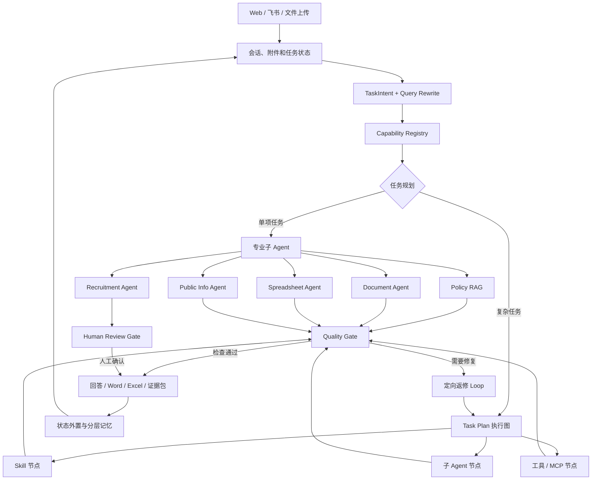
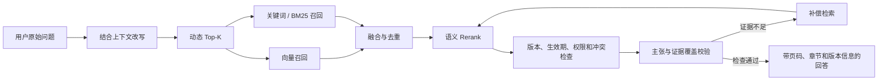

## 系统如何工作

UniHR 把执行分成三层：

- 子 Agent 负责一个专业领域，例如政策问答、公文生成、表格处理、招聘筛选或联网信息；
- Skill 保存已经验证过的业务方法、模板和约束；
- Task Plan 执行图负责复杂任务的先后依赖、并行节点、人工复核和失败返修。

Agent 负责判断当前要做什么，Skill 提供稳定做法，Task Plan 负责把多个能力组织成一次完整交付。

### Policy RAG

政策检索不会把「找到相关文件」直接当成答案。系统会继续判断证据是否覆盖用户真正询问的内容，并检查版本、生效期、权限和冲突。

### 记忆与长任务

UniHR 不会把全部聊天历史无限追加到模型上下文。不同信息保存在不同位置，并在任务需要时加载：

- Working Memory 保存当前目标、约束、最近结果和下一步；
- Thread State / Checkpoint 保存 LangGraph 节点状态，支持暂停和继续；
- Semantic Memory 保存稳定偏好、组织规则和可复用事实；
- Episodic Memory 保存过去任务的关键决策和结果；
- Procedural Memory 通过 Skill 保存可复用工作方法；
- External Memory 保存原文件、表格、报告和证据包，模型只读取当前需要的部分。

长对话达到阈值后，系统压缩低价值历史，保留目标、约束、决策、未完成事项和最近原始上下文。完整数据仍留在工作区，可以在需要核对时重新读取。

[返回项目介绍](../README.md) · [模块与状态设计](ARCHITECTURE.md)

[历史工程评测记录](EVALUATION-NOTES.md)
